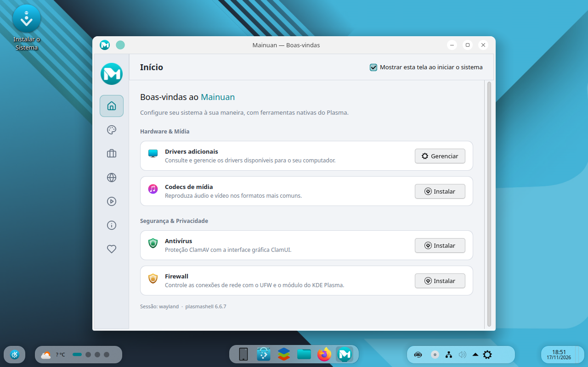
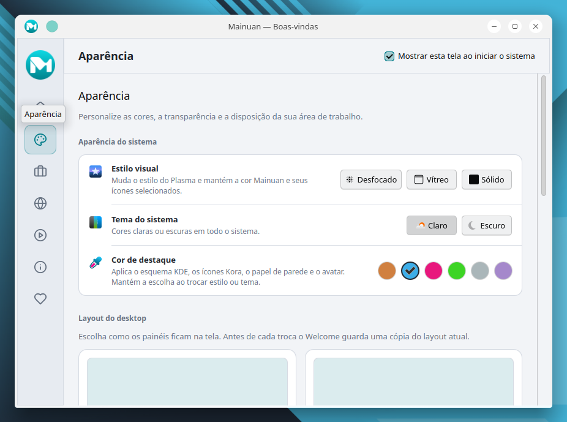
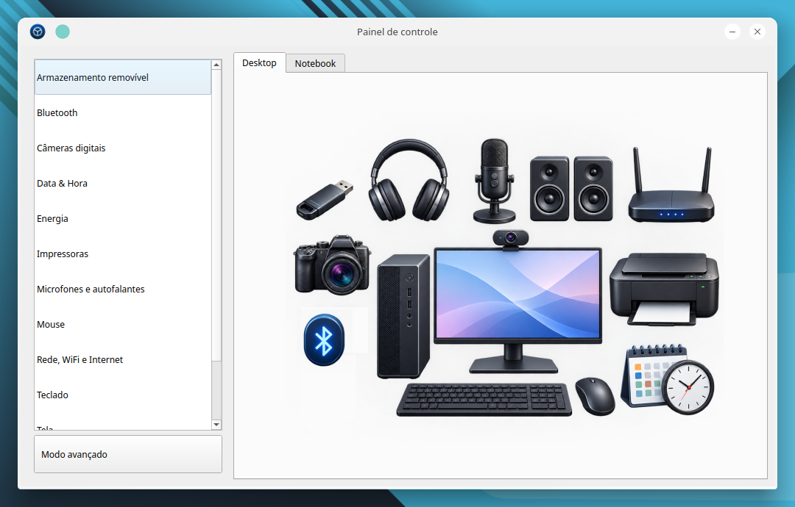

<div align="center">


# Mainuan Linux

**Liberdade, segurança e produtividade, com o KDE Plasma sobre uma base Kubuntu LTS.**

Sucessor oficial do TigerOS.

[](https://mainuan.com.br)
[](https://t.me/mainuan_comunidade)
[](https://github.com/mainuan/build/releases)




</div>

---

## O que é o Mainuan

O Mainuan é um sistema operacional brasileiro, pensado para quem está
saindo do Windows: escritórios, laboratórios, escolas e o uso pessoal. A
interface segue padrões conhecidos, então a equipe continua produtiva
desde o primeiro dia.

Ele usa o **Kubuntu 26.04 LTS** como base, com o **KDE Plasma 6.6** em
**Wayland**. A ele se somam aplicativos próprios, uma identidade visual
completa e configurações prontas para o uso diário. Tudo é software livre,
desenvolvido aqui no GitHub.

## Destaques

| | |
|---|---|
| **Boas-vindas** | Escolha de visual, cores e layout da área de trabalho, codecs e aplicativos essenciais no primeiro login |
| **Gestão de drivers** | Detecção de drivers proprietários (NVIDIA, firmware e outros) com instalação pelo PackageKit e autorização do Plasma |
| **Instalação simples** | Instaladores próprios para `.flatpakref`, AppImage e `.deb`, com verificação de origem e de integridade |
| **Sistema sempre atualizado** | Alerta de atualizações APT e Flatpak ao entrar na sessão e canal oficial de novidades do Mainuan |
| **Painel de Controle** | As configurações do Plasma organizadas num painel único, com atalho `Meta+I` |
| **Editor do GRUB** | Entradas, tema, fontes e parâmetros de boot por interface gráfica |
| **Escritório** | ONLYOFFICE, compatível com documentos corporativos |
| **33 idiomas** | Os aplicativos Mainuan seguem o idioma do Plasma, inclusive árabe, hebraico, persa e urdu (da direita para a esquerda) |

<div align="center">


</div>

## Download

A ISO oficial é publicada em **[mainuan/build › Releases](https://github.com/mainuan/build/releases)**
e no site **[mainuan.com.br](https://mainuan.com.br)**.

O GitHub limita cada arquivo a 2 GiB, por isso a ISO vem em partes:

```bash
sha256sum --check --ignore-missing SHA256SUMS
cat mainuan-*-amd64.iso.part* > mainuan.iso
sha256sum --check --ignore-missing SHA256SUMS
```

Grave num pendrive com o KDE ISO Image Writer, o balenaEtcher ou o GNOME
Disks. Experimente o sistema no modo Live e instale pelo ícone
**Instalar o Sistema**.

A versão atual é a **2027.1 RC1** (*release candidate*). Ela inicia por UEFI,
com ou sem Secure Boot, e por BIOS, e funciona em processadores sem AVX. Foi
testada em máquinas virtuais com 4 vCPU e 6 GiB de RAM. Os testes em
computadores reais ainda estão em andamento: veja os problemas conhecidos
nas notas da release.

## Projetos

| Área | Repositório | |
|---|---|---|
| **Sistema** | [build](https://github.com/mainuan/build) | Construtor da ISO: base verificada, pacotes fixados e testes de boot |
| | [.github](https://github.com/mainuan/.github) | Esta página e o pipeline compartilhado de pacotes Debian |
| **Aplicativos** | [welcome](https://github.com/mainuan/welcome) | Boas-vindas e assistente do primeiro login (C++/Qt 6/Kirigami) |
| | [mainuan-gestao-drivers](https://github.com/mainuan/mainuan-gestao-drivers) | Gestão de drivers (derivado do Driver Manager do Linux Mint) |
| | [alerta-atualizacao](https://github.com/mainuan/alerta-atualizacao) | Alerta de atualizações APT e Flatpak |
| | [atualizador-de-recursos](https://github.com/mainuan/atualizador-de-recursos) | Canal oficial de novidades do Mainuan |
| | [painel-de-controle](https://github.com/mainuan/painel-de-controle) | Painel de Controle para o KDE Plasma |
| | [mainuan-grub-editor](https://github.com/mainuan/mainuan-grub-editor) | Editor gráfico do GRUB |
| **Instaladores** | [mainuan-flatpak-install-gui](https://github.com/mainuan/mainuan-flatpak-install-gui) | Instalador de `.flatpakref` |
| | [mainuan-install-AppImage](https://github.com/mainuan/mainuan-install-AppImage) | Instalador de AppImage |
| | [pkg-manager-gui](https://github.com/mainuan/pkg-manager-gui) | Gerenciador de Flatpak e AppImage |
| | [deb-manager-gui](https://github.com/mainuan/deb-manager-gui) | Janela de progresso para instalar e remover pacotes APT |
| | [instalador-de-fontes](https://github.com/mainuan/instalador-de-fontes) | Instalador de fontes com pré-visualização |
| **Visual** | [plasma-themes](https://github.com/mainuan/plasma-themes) | Temas, esquemas de cores, cursores e widgets do Plasma |
| | [icons](https://github.com/mainuan/icons) | Temas de ícones Kora em seis cores |
| | [wallpapers](https://github.com/mainuan/wallpapers) | Papéis de parede |
| | [dot-files](https://github.com/mainuan/dot-files) | Configuração padrão da área de trabalho e identidade do instalador |
| **Comunidade** | [mainuan.github.io](https://github.com/mainuan/mainuan.github.io) | Artigos e tutoriais |

Cada aplicativo é publicado como pacote Debian testado, com SHA-256, nas
releases do próprio repositório. A ISO usa exatamente essas versões.

## Como contribuir

1. Abra uma *issue* no repositório do componente, com os passos para reproduzir o problema.
2. Para código: faça um *fork*, crie uma branch e abra um *pull request*. O CI compila, roda os testes, gera o `.deb` e o instala num Ubuntu 26.04 limpo.
3. Traduções: cada aplicativo tem `po/` com catálogos gettext e um `docs/i18n/README.md`.

## Comunidade

* Site: <https://mainuan.com.br>
* Telegram: <https://t.me/mainuan_comunidade>

## Quem faz o Mainuan

<a href="https://github.com/natanael-art"></a>
<a href="https://github.com/ruscher"></a>
<a href="https://github.com/daigoasuka"></a>
<a href="https://github.com/selrahcsan"></a>
<a href="https://github.com/guirialli"></a>
<a href="https://github.com/tugatechlabDC"></a>

O Mainuan também se apoia no trabalho do [Kubuntu](https://kubuntu.org),
do [KDE](https://kde.org) e do [Ubuntu](https://ubuntu.com), do
[Linux Mint](https://linuxmint.com) (gestão de drivers), de
[vinceliuice](https://github.com/vinceliuice) (MacTahoe), de
[L4ki](https://github.com/L4ki) (Blur-Glassy) e dos autores dos widgets
e ícones creditados em cada repositório.

## Licenças

Cada repositório tem a própria licença (GPL-3.0, GPL-2.0, MIT e outras),
indicada no arquivo `LICENSE` e no `debian/copyright` de cada pacote.
Componentes de terceiros mantêm as licenças originais.
